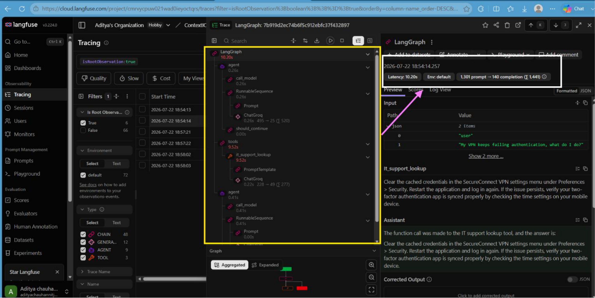
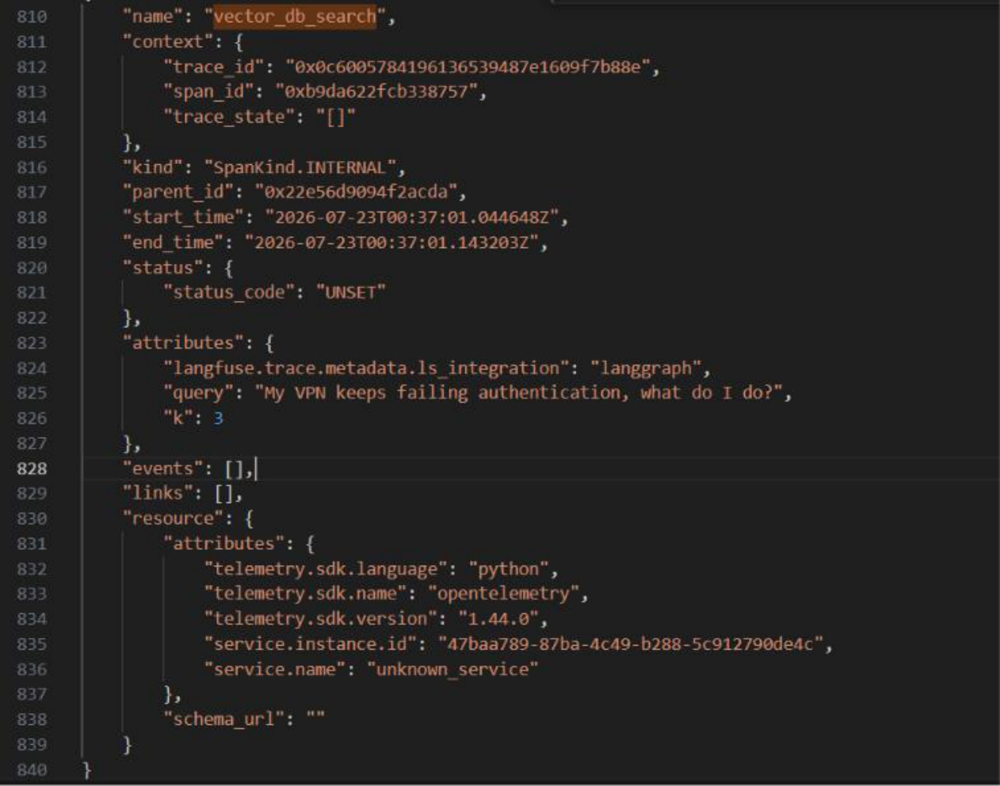

<div align="center">
  <h1>🧠 ContextIQ</h1>
  <p><strong>A scope-gated, agentic IT support system — built to benchmark retrieval strategies and prove that query rejection is a feature, not a fallback.</strong></p>

  [](https://fastapi.tiangolo.com/)
  [](https://reactjs.org/)
  [](https://langchain.com/)
  [](https://www.trychroma.com/)
  [](https://opentelemetry.io/)
  [](https://langfuse.com/)
</div>

<div align="center">
  <b><a href="https://context-iq-frontend-seven.vercel.app/">🌐 Live Demo</a></b> &nbsp;|&nbsp;
  <b><a href="https://youtu.be/iB0DpAtEWZA?si=DufV_p64cXk-fUmC">🎥 Video Demo</a></b> &nbsp;|&nbsp;
  <b><a href="https://docs.google.com/presentation/d/1YjKR_LsQPGX68dEUOVmqeWUsBH6sl-gq/edit?usp=sharing&ouid=105688022393717157912&rtpof=true&sd=true">📊 Architecture Deck</a></b>
</div>

---

## The Problem with Naive RAG

Standard RAG pipelines have a fundamental design flaw for scoped domains: they are unconditionally eager. Every query — regardless of whether it's "my VPN keeps disconnecting" or "who won the World Cup?" — pays the full cost: an embedding call, a vector DB lookup, a retrieval pass, and a full LLM generation. The result is wasted tokens on irrelevant queries and hallucinations when retrieved context doesn't match the question.

**ContextIQ's answer:** treat query rejection as a first-class architectural concern.

---

## What ContextIQ Does Differently

ContextIQ is a **LangGraph ReAct agent** that reasons before it retrieves. It evaluates every query against a strict scope gate (8 enterprise IT categories) before deciding whether to invoke the RAG pipeline. Out-of-scope queries are rejected immediately — zero vector DB calls, zero additional token spend on retrieval.

```
Query → Agent Reasons → [In-scope]  → it_support_lookup tool → ChromaDB → LLM → Answer
                      → [Out-scope] → Rejection (no DB, no extra tokens)
```

This creates a measurable and observable system: token usage, rejection rate, and DB latency are all instrumented — not estimated.

---

## Architecture

### Agent & Gating Layer

The agent is built with LangGraph's `create_react_agent`, which models the agent loop as an explicit directed graph rather than an opaque execution chain. This matters for three reasons:

1. **Inspectability** — every Thought → Action → Observation step is a discrete graph event, streamable and loggable.
2. **Hard safety** — `recursion_limit=8` prevents infinite tool-call loops at the graph level (each tool call traverses 2 edges: agent → tool → agent).
3. **Deprecation-proof** — LangChain's `AgentExecutor` is deprecated; LangGraph is the forward-compatible replacement.

The gating mechanism itself is a **double layer**:
- **System prompt** defines 8 strict IT categories and absolute rejection rules.
- **Tool description** (`TOOL_DESCRIPTION` env var) tells the LLM when the tool is applicable — the LLM reads this docstring as part of its reasoning.

Changing the tool description from `.env` without touching code is what makes tool-gating an A/B testable variable, not a hardcoded constraint.

### Retrieval Layer — Strategy Pattern

Two interchangeable retrieval strategies, selectable at runtime via env var or per-call override:

| Strategy | Mechanism | Token Cost | Context Quality |
|---|---|---|---|
| `metadata_chunk` | Returns raw top-K chunks directly | Low | May lose surrounding context |
| `parent_document` | Uses chunk to find ticket ID → fetches full ticket from in-memory dict | Higher | Full ticket context for LLM |

Both strategies share a common abstract interface (`RetrievalStrategy` ABC), so the RAG chain calls `strategy.retrieve()` without knowing which implementation it gets. Adding a third strategy (e.g., BM25 hybrid) requires zero changes to `rag_chain.py` — Open/Closed Principle applied.

The per-call override (`ask_question(q, strategy_name="parent_document")`) enables A/B testing from a notebook without restarting the server — a genuine advantage over a pure env-var switch.

### Vector Store Layer — Singleton + Custom Embeddings

**ChromaDB Singleton:** `ChromaDBSingleton` uses class-level variables to ensure the `PersistentClient` and embeddings model are initialized exactly once per process. Without this, each request would re-read from disk and re-acquire OS file locks on the ChromaDB directory — measurable overhead on every warm request.

**Custom REST Embeddings:** The `langchain_google_genai` SDK internally routes embedding requests through the `v1beta` endpoint. `text-embedding-004` is not available on `v1beta` — it returns HTTP 404. Rather than downgrading the model, `GoogleRestEmbeddings` calls the stable `v1` REST endpoint directly, implementing the two-method LangChain embeddings interface (`embed_documents`, `embed_query`) as a drop-in replacement. It also supports an automatic fallback to a secondary API key on failure.

### LLM Layer — Factory + Fallback Chain

`get_llm()` is a factory that returns either `ChatGroq` (Llama 3.1 8B) or `ChatGoogleGenerativeAI` (Gemini Flash) based on `LLM_PROVIDER`. The Gemini path is wrapped with `.with_fallbacks([secondary_llm])` — if the primary key hits a rate limit, LangChain transparently retries with the backup key. `temperature=0` on both providers ensures deterministic, fact-grounded answers.

---

## Observability

Langfuse and OpenTelemetry cover different layers of the stack — they are complementary, not redundant.

| | **Langfuse** | **OpenTelemetry** |
|---|---|---|
| **Layer** | LLM Application | Infrastructure |
| **Captures** | Agent reasoning, tool decisions, token counts, prompt latency | Raw vector DB search duration |
| **Blind to** | Database-level operations | LLM internals |
| **Attachment** | `CallbackHandler` in `agent.invoke(config={"callbacks": [...]})` | Manual span in `perform_similarity_search()` |
| **Output** | Langfuse Cloud dashboard | `otel_traces.log` file |

The OTel span around `similarity_search()` is what makes it possible to answer: *"Is the response slow because the LLM is slow, or because ChromaDB is slow?"* Without it, latency is an unattributed black box.

**OTel Singleton Note:** The `TracerProvider` is initialized at module import time (`tracer = setup_opentelemetry()`). If initialized inside a function, each request would register a new global provider without shutting down the old one — leaking `BatchSpanProcessor` background threads. Python's module import cache (`sys.modules`) ensures `setup_opentelemetry()` runs exactly once per process.




---

## A/B Testing Surface

Every behavioral variable is controllable from `.env` — no code changes required:

```bash
# Swap the LLM backend
LLM_PROVIDER=groq               # or: gemini

# Swap embeddings (cloud vs local)
EMBEDDING_PROVIDER=google       # or: huggingface

# Swap retrieval strategy
DEFAULT_RETRIEVAL_STRATEGY=parent_document  # or: metadata_chunk

# Tune chunking
CHUNK_SIZE=400
CHUNK_OVERLAP=50
K_RESULTS=3

# A/B test the gating boundary (changes agent behavior without restart)
TOOL_DESCRIPTION="Use this tool ONLY for VPN, passwords, timesheets..."

# A/B test the answer generation prompt
RAG_SYSTEM_PROMPT="You are an IT support AI. Answer based ONLY on context..."
```

Results are scored in Langfuse: token counts, latency, and prompt quality scores are logged per trace, making comparisons across strategy configurations quantitative rather than subjective.

---

## Project Structure

```
ContextIQ/
├── backend/
│   ├── app/
│   │   ├── main.py                     # FastAPI app, CORS, startup ingestion hook
│   │   ├── config.py                   # Settings class — single source of truth for all env vars
│   │   ├── api/
│   │   │   └── routes.py               # /health + /query endpoints
│   │   ├── core/
│   │   │   ├── agent.py                # LangGraph ReAct agent + system prompt + tool definition
│   │   │   ├── llm_factory.py          # Factory: Gemini or Groq with fallback chain
│   │   │   ├── rag_chain.py            # RAG orchestrator (strategy resolution + prompt + LLM)
│   │   │   ├── retrieval_strategies.py # Strategy ABC + MetadataChunk + ParentDocument
│   │   │   ├── telemetry.py            # Langfuse handler + OTel TracerProvider (singleton)
│   │   │   ├── ticket_parser.py        # Parses .txt knowledge base → structured dicts
│   │   │   └── vectorstore.py          # ChromaDB singleton + custom embeddings + OTel-traced search
│   │   ├── data/
│   │   │   └── dummy_it_tickets.txt    # Knowledge base: structured IT support tickets
│   │   └── models/
│   │       └── schemas.py              # Pydantic: QueryRequest, QueryResponse
│   └── requirements.txt
├── frontend/
│   └── src/
│       ├── App.jsx                     # Root: message state, theme toggle, backend wakeup ping
│       ├── api/client.js               # sendQuery() — typed fetch wrapper with error fallback
│       └── components/
│           ├── ChatWindow.jsx          # Message list with auto-scroll (useRef + useEffect)
│           ├── InputBox.jsx            # Controlled form — disabled during loading
│           └── MessageBubble.jsx       # User/assistant bubble with optional source display
└── docs/assets/                        # Screenshots referenced in README
```

---

## Deployment

### Backend → Render

The backend deploys to Render's free tier with two self-healing behaviors built in:

**1. Auto-ingestion on cold deploy:** `chroma_db/` is gitignored (too large to version). On first Render deploy, it doesn't exist. The `@app.on_event("startup")` hook detects its absence and runs `prepare_and_store_documents()` automatically — parse → chunk → embed → store. Subsequent restarts skip this.

**2. Frontend wakeup ping:** Render free tier idles after 15 minutes. `App.jsx` fires `GET /health` on mount via `useEffect`. This starts the backend warm-up before the user types their first query, converting a ~50s cold-start wait into near-zero perceived latency.

```
# Render Web Service
Root Directory:  backend/
Build Command:   pip install -r requirements.txt
Start Command:   uvicorn app.main:app --host 0.0.0.0 --port 10000
```

Required environment variables on Render:
```
GOOGLE_API_KEY, GOOGLE_API_KEY_FALLBACK
GROQ_API_KEY
LLM_PROVIDER, EMBEDDING_PROVIDER
LANGFUSE_PUBLIC_KEY, LANGFUSE_SECRET_KEY
DEFAULT_RETRIEVAL_STRATEGY, CHUNK_SIZE, CHUNK_OVERLAP, K_RESULTS
TOOL_DESCRIPTION, RAG_SYSTEM_PROMPT
```

### Frontend → Vercel

```
Root Directory:  frontend/
Build Command:   npm run build
```

Set `VITE_API_URL` to your Render service URL (e.g., `https://contextiq-api.onrender.com`).

---

## Local Development

### Backend

```bash
cd backend
python -m venv venv
source venv/Scripts/activate   # Windows Git Bash
# source venv/bin/activate     # Mac/Linux
pip install -r requirements.txt
```

Copy `.env.example` to `.env` and fill in your API keys. Then:

```bash
# First run: build the vector database from the knowledge base
python -m app.core.vectorstore

# Start the API server
python -m app.main
# → http://localhost:8000
# → Swagger UI at http://localhost:8000/docs
```

> The `chroma_db/` directory is gitignored. It must be generated locally via the ingestion step above before the agent can answer queries. On subsequent runs, the existing DB is reused.

### Frontend

```bash
cd frontend
npm install
npm run dev
# → http://localhost:5173
```

Set `VITE_API_URL=http://localhost:8000` in `frontend/.env.local` (or leave unset — it defaults to `localhost:8000`).

---

## Design Decisions & Known Trade-offs

| Decision | Trade-off Accepted |
|---|---|
| ReAct agent over direct RAG chain | +1 LLM call per query (reasoning step); justified by token savings on rejections at scale |
| ChromaDB over managed vector DB (Pinecone) | Single-node, no horizontal scaling; appropriate for prototype scope |
| Custom REST embeddings over SDK | Tighter coupling to Google API contract; necessary to access `text-embedding-004` on stable v1 |
| Module-level OTel init over per-request | Less flexible; necessary to prevent TracerProvider memory leaks in long-running ASGI process |
| Render free tier | 50s cold starts; mitigated by frontend wakeup ping |
| `temperature=0` | Answers can feel robotic; correct trade-off for a fact-retrieval, not creative, task |

---

<div align="center">
  <i>Built during the Accenture Advanced Application Engineering Internship (AEH Batch)</i>
</div>
